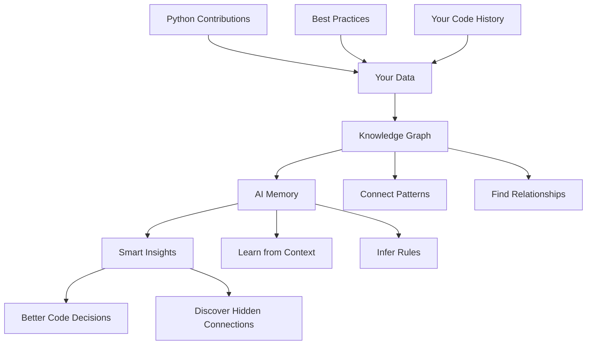

> 📄 English: [README.md](README.md)

# 使用 Cognee 的 AI 记忆

构建一个智能 AI 记忆系统，向 Python 之父学习并改进你的开发工作流。

## 概述

使用 Cognee 将分散的开发数据转化为统一的知识图谱。把 Guido van Rossum 的 Python 贡献与编码最佳实践以及你的个人开发历史连接起来，创建一个能提供上下文相关、可解释答案的 AI 助手。

## 你将学到什么

- **连接不同的数据来源** - 统一 Guido 的 CPython 贡献、PEP 指南、Zen 原则以及你的编码对话
- **构建智能记忆** - 创建理解 Python 设计哲学和最佳实践的知识图谱
- **实现智能搜索** - 用自然语言查询你的知识库，获得结合多视角的洞察
- **发现隐藏模式** - 使用 AI 驱动的分析发现不同数据来源之间非显而易见的联系

## 教程

**[完整教程：cognee-ai-memory.ipynb](./cognee-ai-memory.ipynb)**

本教程展示了知识图谱和检索增强生成（RAG）在软件开发中的强大能力，演示 AI 记忆如何从权威来源学习并增强你的编码实践。
